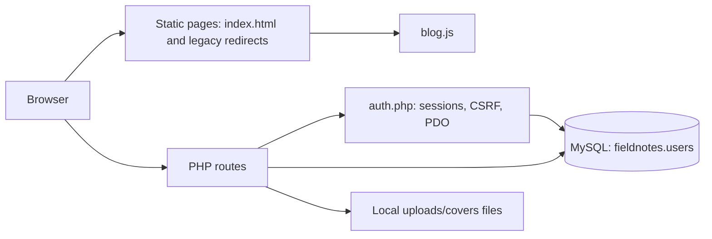

# Fieldnotes Journal: Project Architecture

## Overview

Fieldnotes is a small, server-rendered PHP authentication site paired with a JavaScript-enhanced editorial blog. PHP and MySQL provide account creation, sign-in, session management, admin-route protection, and persistent blog posts. Cover image files are stored under `uploads/covers`; post records store the relative file path or an external image URL.

## Technology Stack

- **Frontend:** HTML, CSS, vanilla JavaScript
- **Backend:** PHP 8+ with PDO
- **Database:** MySQL/MariaDB, using the `fieldnotes` database
- **Local development:** XAMPP PHP/MySQL or PHP's built-in development server
- **External assets:** Google Fonts, Font Awesome, and Unsplash-hosted images

## Request Architecture



The web server must execute PHP files. Opening `index.html` directly with a `file://` URL or through a static-only preview does not provide PHP authentication. Use the PHP server URL instead, for example `http://127.0.0.1:8000/index.html` when the project is served from the workspace root.

## Repository Layout

| File               | Responsibility                                                                                                                                                                    |
| ------------------ | --------------------------------------------------------------------------------------------------------------------------------------------------------------------------------- |
| `index.html`       | Public Fieldnotes homepage: hero, story listing shell, category filters, search, newsletter form, and shared sign-in link.                                                        |
| `blog.css`         | Shared public-blog and admin dashboard visual system, including responsive layouts and toast/story-dialog styling.                                                                |
| `blog.js`          | Public story rendering/search/category filtering, story dialog, newsletter feedback, admin post editor behavior, and homepage auth toast.                                         |
| `admin.php`        | Protected admin entry point. Loads auth helpers, requires the signed-in user to have the `admin` role, then includes the dashboard view.                                          |
| `admin-view.php`   | Admin dashboard markup and logout form. Loads `blog.js` for the browser-local post editor.                                                                                        |
| `posts-api.php`    | JSON API: public published-post previews, signed-in full-story reads, admin-only post CRUD, legacy localStorage import, CSRF checks, and cover-image validation/storage.          |
| `admin.html`       | Legacy static redirect to `admin.php`; it is not the protected dashboard itself.                                                                                                  |
| `signup.php`       | Validates signup POSTs, creates member records, hashes passwords, starts a session, then redirects to the homepage.                                                               |
| `login.php`        | Verifies credentials, upgrades old password hashes when needed, regenerates the session ID, and sends admins to the dashboard and members to the homepage based on stored role.   |
| `logout.php`       | CSRF-protected POST endpoint that clears the session and redirects to the homepage.                                                                                               |
| `auth.php`         | Shared auth infrastructure: secure session cookie settings, MySQL PDO connection/schema initialization, CSRF token helpers, user/session helpers, admin guard, and HTML escaping. |
| `auth-view.php`    | Shared PHP-generated auth page shell and dismissible auth-message close behavior.                                                                                                 |
| `signup.html`      | Legacy redirect to `signup.php`.                                                                                                                                                  |
| `login.html`       | Legacy redirect to `login.php`.                                                                                                                                                   |
| `style.css`        | Signup/sign-in visual theme.                                                                                                                                                      |
| `database.sql`     | Importable MySQL schema for the `fieldnotes` database, `users`, and `posts` tables.                                                                                               |
| `create-admin.php` | CLI-only helper for creating or promoting an administrator account from environment variables.                                                                                    |
| `script.js`        | Leftover from the original single-page auth toggle; current separate auth routes do not use it.                                                                                   |

## Routes and Navigation

| Route           | Method    | Access             | Behavior                                                                                                                                                             |
| --------------- | --------- | ------------------ | -------------------------------------------------------------------------------------------------------------------------------------------------------------------- |
| `index.html`    | GET       | Public             | Shows the blog UI. `blog.js` fetches published stories from `posts-api.php` and provides search/category filtering.                                                  |
| `signup.php`    | GET, POST | Public             | Shows signup form; CSRF-protected POST creates a member account and redirects to `index.html?welcome=1`.                                                             |
| `login.php`     | GET, POST | Public             | Single sign-in form for all accounts; valid members redirect to `index.html?signed-in=1`, while admins redirect to `admin.php`.                                      |
| `admin.php`     | GET       | Admin only         | Requires a signed-in admin session, then renders `admin-view.php`; other users are redirected to the shared `login.php`.                                             |
| `logout.php`    | POST      | Signed-in session  | Validates CSRF, destroys session, and redirects to `index.html`.                                                                                                     |
| `posts-api.php` | GET       | Public / signed-in | Default returns published previews without story bodies. `?id=<post-id>` returns full content only to signed-in users. `?manage=1` returns all posts only to admins. |
| `posts-api.php` | POST      | Admin only         | CSRF-protected create, update, delete, or one-time legacy post import. Accepts multipart cover uploads.                                                              |
| `signup.html`   | GET       | Legacy             | Redirects to `signup.php`.                                                                                                                                           |
| `login.html`    | GET       | Legacy             | Redirects to `login.php`.                                                                                                                                            |
| `admin.html`    | GET       | Legacy             | Redirects to `admin.php`.                                                                                                                                            |

Successful member login and signup use query flags for the static homepage. `blog.js` maps those fixed flags to safe, dismissible welcome messages, then removes the flags from the browser URL. Login/signup validation errors are rendered in the PHP response as dismissible alert messages.

## Authentication Flow

1. Signup and login pages request a CSRF token from `auth.php` and include it in the POST form.
2. On POST, the route validates the token before processing credentials.
3. Signup validates the email/name/password and inserts an account using a prepared PDO statement. Passwords are stored using PHP `password_hash()`; passwords are never stored as plain text.
4. Login looks up the account by email and uses `password_verify()`. If needed, it rehashes the password using the current `PASSWORD_DEFAULT` algorithm.
5. Successful sign-in regenerates the session ID and stores only account identity/role in the session.
6. `admin.php` checks that session role before including any dashboard markup.
7. Logout is a CSRF-protected POST and destroys the session.

Public signup always creates `member` accounts. All account types use the same login page; after authentication, `login.php` routes admins to the dashboard and members to the homepage based on the stored database role. Admin creation/promotion is intentionally kept in the CLI-only `create-admin.php` utility. The homepage has one sign-in link and no separate admin link.

### Seeded local administrator

An administrator account was seeded in the local `fieldnotes` database for development:

- Email: `admin@fieldnotes.local`
- Password: `5D113E9E7E5933CC334504090A8F1454ADCC6E941DE4C57B!a9`
- Sign-in: `http://127.0.0.1:8000/login.php`

Change this password after the first login. Do not use this development credential in production.

## Data Model

### `users`

| Column          | Type                     | Notes                       |
| --------------- | ------------------------ | --------------------------- |
| `id`            | `BIGINT UNSIGNED`        | Auto-increment primary key. |
| `first_name`    | `VARCHAR(80)`            | Required.                   |
| `last_name`     | `VARCHAR(80)`            | Required.                   |
| `email`         | `VARCHAR(254)`           | Required, unique.           |
| `password_hash` | `VARCHAR(255)`           | Required PHP password hash. |
| `role`          | `ENUM('member','admin')` | Defaults to `member`.       |
| `created_at`    | `TIMESTAMP`              | Defaults to creation time.  |

`auth.php` creates the database and table if they do not already exist. `database.sql` contains the equivalent schema for phpMyAdmin/manual setup.

### `posts`

| Column                     | Type                   | Notes                                                        |
| -------------------------- | ---------------------- | ------------------------------------------------------------ |
| `id`                       | `BIGINT UNSIGNED`      | Auto-increment primary key.                                  |
| `author_id`                | `BIGINT UNSIGNED NULL` | References `users.id`; set to `NULL` if the user is removed. |
| `title`                    | `VARCHAR(160)`         | Required story title.                                        |
| `excerpt`                  | `VARCHAR(240)`         | Required listing introduction.                               |
| `content`                  | `MEDIUMTEXT`           | Full story body.                                             |
| `category`                 | `ENUM`                 | `Living`, `Culture`, `Places`, or `Practice`.                |
| `image_path`               | `VARCHAR(255) NULL`    | Uploaded relative path or external HTTP(S) image URL.        |
| `status`                   | `ENUM`                 | `Published` or `Draft`; defaults to `Draft`.                 |
| `created_at`, `updated_at` | `TIMESTAMP`            | Creation and last-update times.                              |

`auth.php` creates the table and inserts the four starter stories if their titles are not present. Existing browser-only posts from `fieldnotes.posts.v1` can be imported from the admin page; the old key is removed only after the API confirms success.

Uploaded cover files are kept in `uploads/covers` with random server-generated names. The API verifies image MIME type and image contents, accepts JPEG/PNG/WebP only, and limits uploads to 5 MB. MySQL stores only the relative path, not the binary image data.

## Member Features

Implemented member account features include signup, sign-in/sign-out, password-authenticated sessions, and full-story reading. Guests can browse previews, search, and filter by category, but must create an account or sign in to open a complete article. The reader prompt carries a validated local return path so the selected story opens after authentication. There is no member-only reading list, profile management, comments, likes, newsletter subscription storage, or password reset yet.

## Configuration and Local Setup

The MySQL connection reads these environment variables:

| Variable                 | Default      |
| ------------------------ | ------------ |
| `FIELDNOTES_DB_HOST`     | `127.0.0.1`  |
| `FIELDNOTES_DB_PORT`     | `3306`       |
| `FIELDNOTES_DB_NAME`     | `fieldnotes` |
| `FIELDNOTES_DB_USER`     | `root`       |
| `FIELDNOTES_DB_PASSWORD` | Empty string |

The defaults are intended for a local XAMPP development installation. For deployment, set a dedicated database user/password and use HTTPS. Avoid using MySQL `root` in a production environment.

### Start locally

From the project directory, start PHP's built-in server:

```powershell
php -S 127.0.0.1:8000 -t .
```

Ensure the XAMPP MySQL service is running, then open:

```text
http://127.0.0.1:8000/index.html
```

The application will create `fieldnotes`, its `users` and `posts` tables, and starter posts on first database access. To create the first administrator from PowerShell, set `FIELDNOTES_ADMIN_EMAIL`, `FIELDNOTES_ADMIN_PASSWORD` (minimum 16 characters), and optionally `FIELDNOTES_ADMIN_FIRST_NAME` / `FIELDNOTES_ADMIN_LAST_NAME`, then run:

```powershell
php create-admin.php
```

The schema can also be imported in phpMyAdmin using `database.sql`. Uploaded image files must be kept with the app's `uploads/covers` directory when backing up or deploying the database.

## Security Notes and Current Limitations

- Authentication forms use prepared SQL statements, CSRF tokens, password hashing, session ID regeneration, `HttpOnly`/`SameSite=Lax` cookies, and escaped output.
- The session cookie's `Secure` flag is enabled when PHP detects HTTPS. Use HTTPS outside local development.
- The default database credentials are local-development defaults; set deployment environment variables before hosting publicly.
- There is no password reset or email verification flow.
- There is no rate limiting or account lockout on repeated login attempts.
- Newsletter signup currently only displays a browser-side confirmation; subscriber addresses are not persisted.
- Post content is database-backed, but an uploaded image is a filesystem asset. Back up both MySQL and `uploads/covers`.
- `index.html` stays static so its auth-success toast is handled client-side; it does not read session state or display a personalized account state.
